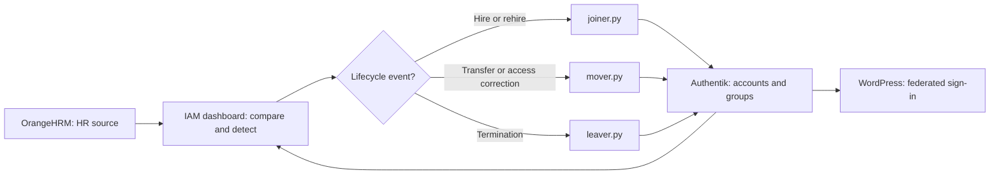
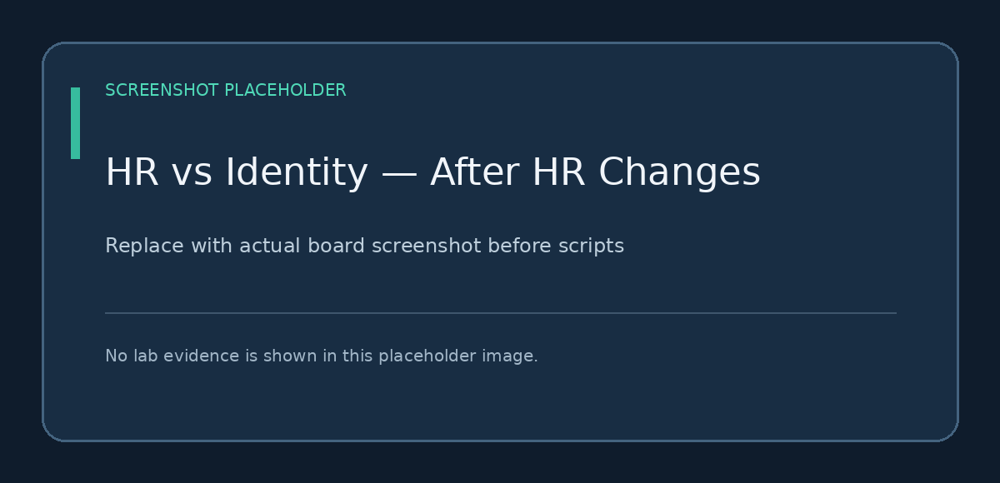
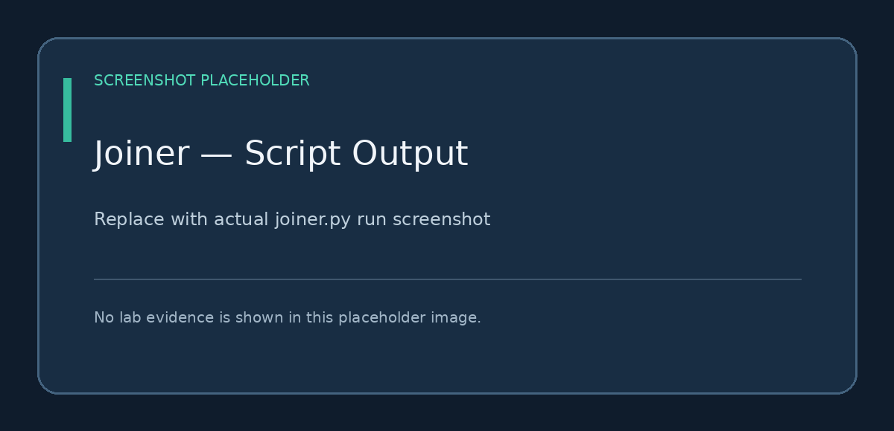
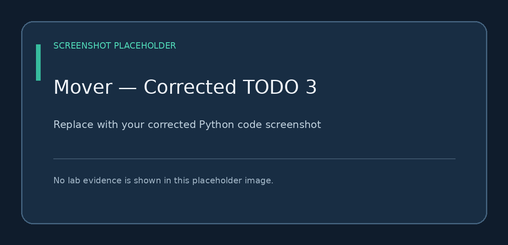
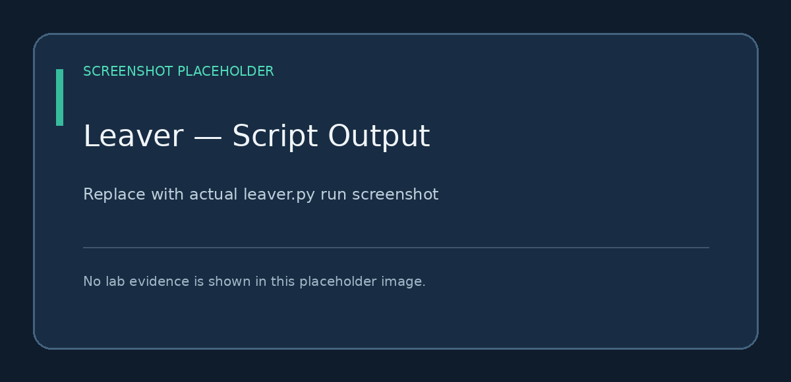

# HR-Driven IAM Lifecycle Automation

### Joiner–Mover–Leaver (JML) Capstone | OrangeHRM + Authentik + Python

**Portfolio project:** An end-to-end identity lifecycle exercise built around HR events, automated account provisioning and deprovisioning, department-based group memberships, and reconciliation between an HR system and an identity provider.

**Technologies:** Python · OrangeHRM · Authentik · RBAC · HR-driven provisioning · Identity lifecycle management · IAM Dashboard · GitHub

> **Project context:** Completed in the **All Things Identity — IAM Career Launchpad** learning environment. Employee data is fictional. The Illyana access-creep screenshot is from the actual lab; other screenshot slots are clearly labeled placeholders until replaced with additional evidence. The Python scripts are built for the hosted lab and import its `jml_common` helpers; they are not a self-contained production deployment.

## At a glance

| Component | Role |
|---|---|
| OrangeHRM | Authoritative HR source for employees, status, and organizational subunit |
| Authentik | Identity provider storing accounts and department access groups |
| Python (`joiner.py`, `mover.py`, `leaver.py`) | Automates onboarding, department transfers, rehires, and offboarding |
| IAM Lab Dashboard | Compares HR state with identity state and runs the scripts |
| WordPress | Sample application relying on Authentik for sign-in (not directly modified in this capstone) |

**Primary goal:** Make identity state in Authentik match employee state in OrangeHRM while preventing unauthorized access and stale group membership.

## Architecture and workflow



The scripts match HR employees with identity accounts using **work email**, determine required department membership from the HR **Sub Unit**, and reconcile identity access. The capstone is run manually through the lab dashboard.

## Business scenario: a week of HR changes

The capstone simulated five real-world IAM events:

| Day-one change | HR action | Desired identity outcome | Script(s) |
|---|---|---|---|
| **Sam Wilson** | New hire, **Avengers** | Create account; assign `dept-avengers` | Joiner |
| **Carol Danvers** | New hire, **Cosmic Division** | Create account; assign `dept-cosmic-division` | Joiner |
| **Illyana Rasputin** | Transfer from **X-Men** to **Defenders** | Assign `dept-defenders`; remove `dept-x-men` | Mover |
| **Billy Kaplan** | Termination | Disable account; remove all department access | Leaver |
| **Jessica Jones** | Rehire, **Defenders** | Re-enable existing account; restore `dept-defenders` | Joiner **and** Mover |

### Prediction before running automation

The purpose was to recognize discrepancies before changing access:

| Identity finding | Person | Reason | Planned remediation |
|---|---|---|---|
| No account yet | Sam Wilson | Employee exists in HR, not identity | `joiner.py` |
| No account yet | Carol Danvers | Employee exists in HR, not identity | `joiner.py` |
| Wrong groups | Illyana Rasputin | Identity group does not match new department | `mover.py` |
| Terminated but still active | Billy Kaplan | HR termination has not been reflected in identity | `leaver.py` |
| Employed but account disabled | Jessica Jones | Rehired employee has disabled existing identity | `joiner.py`, then `mover.py` |

> The lab's expected checkpoint immediately after the five HR changes is **13 rows / 3 findings**; the two *No account yet* rows are not counted as findings. Extra pre-existing test accounts may change the row count.



## Automation design

### 1. Joiner — account provisioning and reactivation

**`scripts/joiner.py`** handles employees who are active in HR but have no account or have a disabled account from a prior termination.

- Provisions an account for Sam Wilson and assigns `dept-avengers`.
- Provisions an account for Carol Danvers, creating or using `dept-cosmic-division` as required by the lab.
- Re-enables Jessica Jones's existing identity following rehire.

**Important edge case:** Re-enabling a returning account does **not** automatically restore previously removed department groups. That requires the mover.



### 2. Mover — least-privilege department access

**`scripts/mover.py`** compares the user's current department group memberships with the department in OrangeHRM. It adds the new group if necessary and removes obsolete groups to prevent **access creep**.

#### Actual troubleshooting: Illyana retained access to two departments

During validation, Illyana's HR Sub Unit was **Defenders**, but the identity dashboard showed both:

```text
Current groups: dept-x-men, dept-defenders
Required group: dept-defenders
Finding: Wrong groups
```

I inspected the Python script and identified an **indentation error**: the `for old in has_now:` removal loop had been placed outside the main loop that iterates over employees. That meant the old-group removal logic did not run for each employee as intended.

I corrected the indentation so each employee's stale memberships were checked and removed. The key lab logic is:

```python
# Inside: for emp in hr_employees():
for old in has_now:
    if old != should_have:
        ak_remove_from_group(user, old)
```

The corrected script was run, and Illyana's old X-Men access was removed.

**Production design consideration:** This training-lab logic assumes groups being reconciled are department groups. In a real environment, removal should be restricted to **managed department groups**, preserving unrelated security or application entitlements.





### 3. Leaver — timely access revocation

**`scripts/leaver.py`** checks terminated HR employees and disables their identity accounts while removing group memberships. This reduces the risk of former employees retaining application access or residual entitlements.

In this scenario, Billy Kaplan was terminated in OrangeHRM and required corresponding offboarding in Authentik.



### 4. Rehire — an intentional two-script workflow

Jessica Jones was previously terminated, so her identity existed but was disabled and no longer had department groups.

1. **Joiner** re-enabled her existing identity.
2. **Mover** reassigned `dept-defenders` based on her current HR department.

This exercise demonstrates why **account state** and **authorization/group state** are separate lifecycle concerns.

## Validation and evidence

The capstone guide's expected final checkpoint is **13 rows / 0 findings** after all three scripts run, assuming the standard lab baseline and no extra test accounts.

**Verify this against your live dashboard before claiming completion:** record your observed numbers in [`docs/VALIDATION_LOG.md`](docs/VALIDATION_LOG.md), then replace the screenshot below with the final dashboard capture.


### Acceptance checks

- [ ] Sam Wilson is active and a member of `dept-avengers`.
- [ ] Carol Danvers is active and a member of `dept-cosmic-division`.
- [x] Illyana Rasputin no longer retains `dept-x-men` after moving to Defenders.
- [ ] Billy Kaplan is disabled with department groups removed.
- [ ] Jessica Jones is re-enabled and assigned `dept-defenders`.
- [ ] Dashboard has **0 findings** (verify actual row count).
- [ ] Screenshots and updated scripts have been uploaded.

The unchecked boxes intentionally distinguish **expected outcomes** from the evidence that still needs to be recorded in this repository.

## What I learned

- **HR-driven IAM:** Employment status and organizational assignments should drive downstream identity changes.
- **RBAC and least privilege:** Grant access that matches a person's current responsibilities, and remove outdated access promptly.
- **Troubleshooting Python automation:** A minor indentation error can leave stale permissions behind while other updates appear to succeed.
- **Rehire complexity:** Re-enabling an account and regranting appropriate access are separate operations.
- **Validation before and after:** Baseline checks, predictions, script outputs, and reconciliation results are all part of demonstrating a reliable workflow.

## Future improvements

1. **Scheduled reconciliation:** Move beyond manually running the scripts to routine or event-driven checks.
2. **Auditability:** Add structured logging with timestamps, employee identifiers, actions, and outcomes (without logging credentials).
3. **Safer entitlement scoping:** Limit automatic group removal to department groups explicitly managed by this workflow.
4. **Exception handling and testing:** Introduce retry handling, dry-run mode, and tests for terminations, rehires, and unusual group configurations.
5. **Alerting:** Surface unresolved discrepancies to the IAM operations team for review.

## Repository structure

```text
jml-lab/
├── README.md                    # This portfolio overview
├── SETUP.md                     # Step-by-step upload and customization guide
├── .gitignore                   # Excludes secrets and local artifacts
├── scripts/
│   ├── README.md                # Where to place downloaded lab scripts
│   ├── joiner.py                # Add YOUR downloaded file
│   ├── mover.py                 # Add YOUR corrected downloaded file
│   └── leaver.py                # Add YOUR downloaded file
├── screenshots/
│   ├── 01-hr-changes-board.png  # Replace labeled placeholder
│   ├── 02-joiner-output.png
│   ├── 03-mover-finding.png
│   ├── 04-mover-code-fix.png
│   ├── 05-mover-output.png
│   ├── 06-leaver-output.png
│   └── 07-final-dashboard.png
└── docs/
    ├── VALIDATION_LOG.md       # Expected vs. observed test outcomes
    ├── EVIDENCE_GUIDE.md       # What screenshots to capture
    └── INTERVIEW_NOTES.md      # Recruiter-ready project walkthrough
```

> **Running the project:** The lab-provided scripts use `jml_common`, hosted service connections, and credentials supplied by the learning environment. This repository documents the work and shares authorized script code, but it does **not** publish tokens, passwords, or infrastructure configuration needed to independently run the hosted lab.

## Interview-ready summary

> “I built and tested HR-driven Joiner–Mover–Leaver automation using Python, OrangeHRM, and Authentik. I simulated hires, a department transfer, a termination, and a rehire. During testing, I detected access creep, traced the issue to a Python indentation error, corrected the mover logic, and verified the outdated entitlement was removed.”

---

**Credits:** Based on the *Your First Week as the IAM Admin* capstone from All Things Identity — IAM Career Launchpad. All employee examples are fictional training data.
