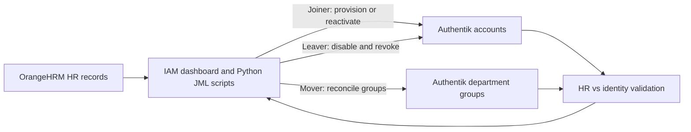
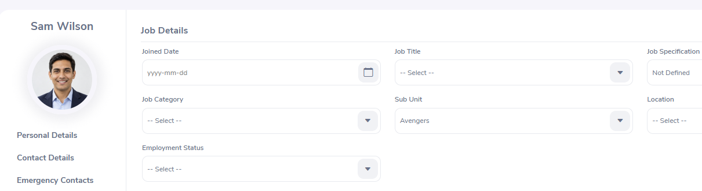
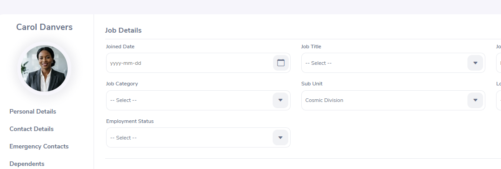
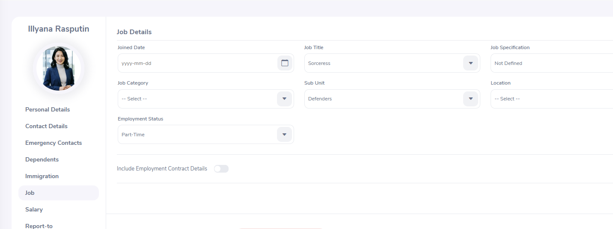
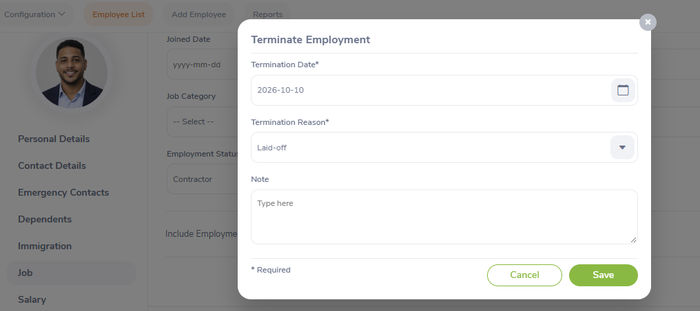
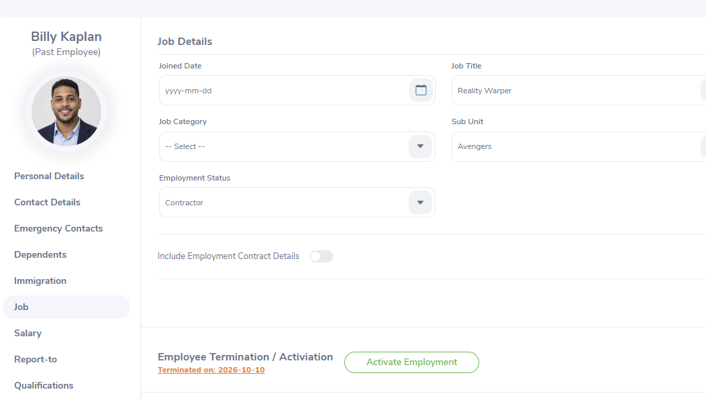
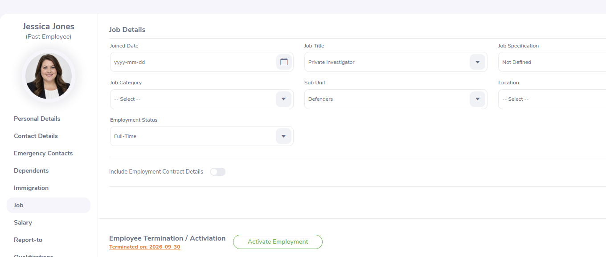
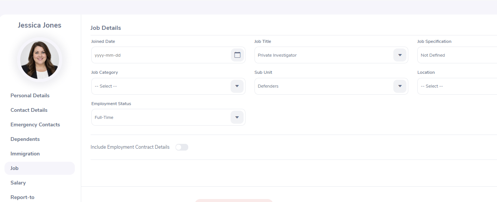
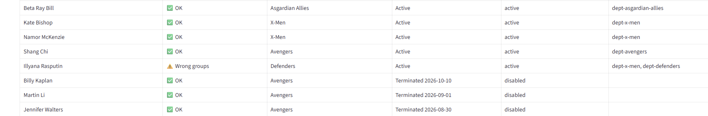

# Identity Lifecycle Automation | Python, Authentik & OrangeHRM

**Hands-on IAM engineering project** · Joiner–Mover–Leaver (JML) · RBAC · HR-driven provisioning · Identity reconciliation

Developed, executed, and troubleshot Python-based identity lifecycle workflows in a **simulated enterprise IAM environment**. The project aligns employee status and department assignments in OrangeHRM with account status and group membership in Authentik. It covers hiring, internal transfers, termination, and rehire—including the investigation and remediation of an observed access-creep finding within the lab.

## Results at a glance

| Validation checkpoint | Employee records | IAM findings |
|---|---:|---:|
| Clean baseline | 11 | **0** |
| After five HR changes, before automation | 13 | **3** |
| After JML automation and remediation | **13** | **0** |

**Outcome:** Reconciled all 13 employee records with zero outstanding HR-to-identity findings. Corrected a Python group-removal defect that allowed a transferred employee to retain access to a previous department.

## Environment and architecture

| Component | Function |
|---|---|
| **OrangeHRM** | Authoritative source for employee status, work email, and department (Sub Unit) |
| **Authentik** | Identity provider holding user accounts and department-based access groups |
| **Python** | Joiner, mover, and leaver workflows through the lab-provided `jml_common` functions |
| **IAM Lab Dashboard** | Runs the scripts and compares HR records with identity account status and access |
| **WordPress** | Sample application configured to authenticate through Authentik; not directly modified in this project |



Employees are matched using **work email**. Department group names derive from HR **Sub Unit** values. The workflows were executed manually through the hosted lab dashboard rather than deployed as scheduled production services.

## Business scenario: five lifecycle events

| Employee | HR change | Expected identity action | Automation |
|---|---|---|---|
| **Sam Wilson** | New hire — Avengers | Create account; assign `dept-avengers` | `joiner.py` |
| **Carol Danvers** | New hire — Cosmic Division | Create account; assign `dept-cosmic-division` | `joiner.py` |
| **Illyana Rasputin** | Transfer — X-Men → Defenders | Add `dept-defenders`; remove `dept-x-men` | `mover.py` |
| **Billy Kaplan** | Employment termination | Disable account and remove department access | `leaver.py` |
| **Jessica Jones** | Rehire — Defenders | Reactivate existing account and restore `dept-defenders` | `joiner.py` + `mover.py` |

### Predicting the findings before running automation

Before executing scripts, I compared each HR change against the expected identity state. Two hires appeared as **No account yet**; three additional issues were counted by the lab dashboard as findings:

| Finding | Affected employee | Remediation |
|---|---|---|
| No account yet *(not counted as a finding)* | Sam Wilson | Joiner |
| No account yet *(not counted as a finding)* | Carol Danvers | Joiner |
| Wrong groups | Illyana Rasputin | Mover |
| Terminated but still active | Billy Kaplan | Leaver |
| Employed but account disabled | Jessica Jones | Joiner, then Mover |

### Evidence: before and after the HR changes

**Baseline — 11 records, 0 findings.** Before changing HR records, I confirmed that employee and identity states were synchronized.


**After HR updates — 13 records, 3 findings.** The hires, transfer, termination, and rehire created the expected discrepancies before automation was executed.


### Employee profile evidence — OrangeHRM

The following screenshots document the **HR-side records and lifecycle actions** that drove the identity automation. They complement the IAM dashboard and script output above; a profile screenshot alone does not verify provisioning or access revocation in Authentik.

<details>
<summary><strong>View employee profile evidence (7 screenshots)</strong></summary>

#### New hire — Sam Wilson

Sam's OrangeHRM job record shows his assigned **Avengers** subunit. The joiner workflow subsequently provisioned his identity and associated department access.



#### New hire — Carol Danvers

Carol's OrangeHRM job record shows **Cosmic Division**, the source department for her identity group assignment.



#### Department transfer — Illyana Rasputin

Illyana's OrangeHRM job record shows her new **Defenders** subunit. Her access discrepancy and remediation are documented separately in the mover section.



#### Termination — Billy Kaplan

The termination dialog shows the selected effective date and reason before submission; the subsequent job profile confirms Billy's **Past Employee** status.





#### Rehire — Jessica Jones

Jessica's record initially shows **Past Employee** and the **Activate Employment** action. The second screenshot shows her job profile after reactivation, without the Past Employee label. Her Authentik account and group restoration are verified in the final reconciliation dashboard.





</details>

## Automation implementation

### 1. Joiner — account provisioning and reactivation

**[`joiner.py`](scripts/joiner.py)** identifies active HR employees without an identity account, creates their Authentik accounts, and assigns the appropriate department group. For returning employees with disabled accounts, it restores account activation.

- Provisioned Sam Wilson with `dept-avengers`.
- Provisioned Carol Danvers with `dept-cosmic-division`.
- Reactivated Jessica Jones's previously disabled identity.

**Rehire consideration:** Re-enabling an existing account does not restore department groups removed at termination. The mover workflow reconciles the returning employee's access separately.

<details>
<summary>Joiner implementation and execution evidence</summary>


</details>

### 2. Mover — least-privilege department access

**[`mover.py`](scripts/mover.py)** compares an employee's Authentik group membership with the department recorded in OrangeHRM. It grants the required department group and removes outdated access to reduce **access creep**.

#### Security finding: old department access retained

After Illyana Rasputin transferred to Defenders, her identity retained both the old and new department groups:

```text
HR Sub Unit:      Defenders
Current groups:   dept-x-men, dept-defenders
Required group:   dept-defenders
Dashboard finding: Wrong groups
```



*Figure 1 — Access creep: the identity retained access from a previous department.*

#### Root cause and remediation

I inspected the mover script and found that the `for old in has_now:` removal loop had been placed **outside** the employee-processing loop. Consequently, old-group removal was not evaluated for each employee as intended.

I corrected the indentation, reran the script, and verified that `dept-x-men` was removed while `dept-defenders` remained assigned. The relevant corrected logic is:

```python
# Within the employee-processing loop:
for old in has_now:
    if old != should_have:
        ak_remove_from_group(user, old)
```

**Observed remediation output:**

```text
- illyana.rasputin removed from dept-x-men
Mover done.
```


*Figure 2 — Mover remediation evidence from the IAM lab.*

**Production design consideration:** The lab's group-removal logic assumes the reconciled memberships are department groups. In a production environment, the workflow should remove **only explicitly managed department groups**, preserving unrelated security, application, and privileged-access entitlements.

### 3. Leaver — account deactivation and access revocation

**[`leaver.py`](scripts/leaver.py)** identifies terminated employees, disables their Authentik accounts, and removes assigned department groups. This addresses the risk of former employees retaining active access.

In this scenario, Billy Kaplan's HR termination was reconciled with a disabled account and no department memberships.

<details>
<summary>Leaver workflow evidence</summary>


</details>

### 4. Rehire — coordinating account and access state

Jessica Jones's rehire required two separate actions:

1. **Joiner:** Re-enable her existing Authentik identity.
2. **Mover:** Reassign `dept-defenders`, since the prior termination had removed department memberships.

This case illustrates why **authentication account state** and **authorization/group membership** must be reconciled independently during a rehire.

## Final validation

The final **HR vs Identity** dashboard confirmed all five lifecycle events were reconciled successfully:

| Employee | Verified state |
|---|---|
| Sam Wilson | Active; `dept-avengers` |
| Carol Danvers | Active; `dept-cosmic-division` |
| Illyana Rasputin | Active; `dept-defenders` only |
| Billy Kaplan | Terminated in HR; identity disabled; no department groups |
| Jessica Jones | Rehired and active; `dept-defenders` |

**Final result: 13 records · 0 findings.**


*Figure 3 — Final reconciliation: HR and Authentik agree on employee status and department access.*

## Engineering takeaways

- **Identity lifecycle changes must follow the authoritative HR record.** Hiring, transfers, terminations, and rehires have different effects on account and access state.
- **Adding the correct access is only half a mover workflow.** Removing prior department memberships is essential for least privilege and preventing access creep.
- **A successful script run is not the same as a correct security outcome.** Dashboard reconciliation and inspection of script output exposed the Python control-flow defect.
- **Rehires may require multiple workflows.** Account activation and entitlement restoration are separate operations.

## Production-oriented improvements

The current project uses manually executed scripts and lab-provided APIs. To strengthen a production implementation, I would add:

1. **Scheduled or event-driven reconciliation** to process HR changes promptly.
2. **Structured audit logging** with timestamps, identity identifiers, actions, and results—without secrets.
3. **Scoped entitlement removal** limited to groups this workflow owns.
4. **Error handling and automated tests** for API failures, rehires, duplicate records, and unusual group assignments.
5. **Alerts and approvals** for unresolved identity discrepancies and higher-risk entitlements.

## Repository navigation

| Location | Contents |
|---|---|
| [`scripts/`](scripts/) | Joiner, mover, and leaver Python source files and script documentation |
| [`screenshots/`](screenshots/) | Lab evidence and screenshots |
| [`docs/VALIDATION_LOG.md`](docs/VALIDATION_LOG.md) | Validation record |


## Execution Scope

This project demonstrates hands-on IAM engineering experience through the implementation, troubleshooting, and validation of Python-based Joiner-Mover-Leaver (JML) automation in a simulated enterprise environment.

Using **OrangeHRM, Authentik, and Python**, I implemented and tested identity lifecycle workflows, investigated HR-to-identity discrepancies, and identified and corrected a Python control-flow error that prevented the removal of outdated department group memberships.

### Key Accomplishments

- **Identity Lifecycle Automation:** Implemented and tested employee onboarding, department transfers, terminations, and rehire workflows.
- **Role-Based Access Control (RBAC):** Applied department-based access management and least-privilege principles to align permissions with current job responsibilities.
- **Access-Creep Remediation:** Identified and resolved an access-control discrepancy by troubleshooting Python automation and correcting group-removal logic.
- **Identity Reconciliation:** Validated the successful synchronization of **13 employee records with zero outstanding identity findings**.

### Technical Scope

The Python scripts leverage provided `jml_common` integration helpers for communication with OrangeHRM and Authentik. Independent execution requires the supporting services, API integrations, and appropriate environment configuration.

This project represents practical IAM engineering experience gained through implementation, troubleshooting, and validation in a simulated environment rather than a production deployment.

---

**Skills Demonstrated:** Python · IAM Lifecycle Management · RBAC · Least Privilege · Identity Provisioning & Deprovisioning · Access-Creep Remediation · Root Cause Analysis · Identity Reconciliation
