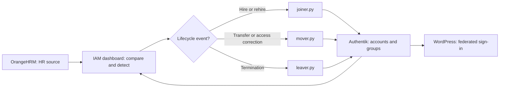

# HR-Driven IAM Lifecycle Automation

### Joiner–Mover–Leaver (JML) Capstone | OrangeHRM + Authentik + Python

**Portfolio project:** An end-to-end identity lifecycle exercise built around HR events, automated account provisioning and deprovisioning, department-based group memberships, and reconciliation between an HR system and an identity provider.

**Technologies:** Python · OrangeHRM · Authentik · RBAC · HR-driven provisioning · Identity lifecycle management · IAM Dashboard · GitHub

> **Project context:** Completed in the **All Things Identity — IAM Career Launchpad** learning environment. Employee data is fictional. The Illyana access-creep screenshot is from the actual lab; other screenshot slots are clearly labeled placeholders until replaced with additional evidence. The Python scripts are built for the hosted lab and import its `jml_common` helpers; they are not a self-contained production deployment.

## At a glance

| Component | Role |
|---|---|
| OrangeHRM | Authoritative HR source for employees, status, and organizational subunit |
| Authentik | Identity provider storing accounts and department access groups |
| Python (`joiner.py`, `mover.py`, `leaver.py`) | Automates onboarding, department transfers, rehires, and offboarding |
| IAM Lab Dashboard | Compares HR state with identity state and runs the scripts |
| WordPress | Sample application relying on Authentik for sign-in (not directly modified in this capstone) |

**Primary goal:** Make identity state in Authentik match employee state in OrangeHRM while preventing unauthorized access and stale group membership.

## Architecture and workflow



The scripts match HR employees with identity accounts using **work email**, determine required department membership from the HR **Sub Unit**, and reconcile identity access. The capstone is run manually through the lab dashboard.

## Business scenario: a week of HR changes

The capstone simulated five real-world IAM events:

| Day-one change | HR action | Desired identity outcome | Script(s) |
|---|---|---|---|
| **Sam Wilson** | New hire, **Avengers** | Create account; assign `dept-avengers` | Joiner |
| **Carol Danvers** | New hire, **Cosmic Division** | Create account; assign `dept-cosmic-division` | Joiner |
| **Illyana Rasputin** | Transfer from **X-Men** to **Defenders** | Assign `dept-defenders`; remove `dept-x-men` | Mover |
| **Billy Kaplan** | Termination | Disable account; remove all department access | Leaver |
| **Jessica Jones** | Rehire, **Defenders** | Re-enable existing account; restore `dept-defenders` | Joiner **and** Mover |

### Prediction before running automation

The purpose was to recognize discrepancies before changing access:

| Identity finding | Person | Reason | Planned remediation |
|---|---|---|---|
| No account yet | Sam Wilson | Employee exists in HR, not identity | `joiner.py` |
| No account yet | Carol Danvers | Employee exists in HR, not identity | `joiner.py` |
| Wrong groups | Illyana Rasputin | Identity group does not match new department | `mover.py` |
| Terminated but still active | Billy Kaplan | HR termination has not been reflected in identity | `leaver.py` |
| Employed but account disabled | Jessica Jones | Rehired employee has disabled existing identity | `joiner.py`, then `mover.py` |

> The lab's expected checkpoint immediately after the five HR changes is **13 rows / 3 findings**; the two *No account yet* rows are not counted as findings. Extra pre-existing test accounts may change the row count.

## Baseline — Before HR Changes

Before processing the employee lifecycle events,
I verified that OrangeHRM and Authentik were synchronized.

**Initial validation: 11 rows, 0 findings.**

 


## Dashboard after HR changes  


## Automation design

### 1. Joiner — account provisioning and reactivation

**`scripts/joiner.py`** handles employees who are active in HR but have no account or have a disabled account from a prior termination.

- Provisions an account for Sam Wilson and assigns `dept-avengers`.
- Provisions an account for Carol Danvers, creating or using `dept-cosmic-division` as required by the lab.
- Re-enables Jessica Jones's existing identity following rehire.

**Important edge case:** Re-enabling a returning account does **not** automatically restore previously removed department groups. That requires the mover.


### 2. Mover — least-privilege department access

**`scripts/mover.py`** compares the user's current department group memberships with the department in OrangeHRM. It adds the new group if necessary and removes obsolete groups to prevent **access creep**.

#### Actual troubleshooting: Illyana retained access to two departments

During validation, Illyana's HR Sub Unit was **Defenders**, but the identity dashboard showed both:

```text
Current groups: dept-x-men, dept-defenders
Required group: dept-defenders
Finding: Wrong groups
```

I inspected the Python script and identified an **indentation error**: the `for old in has_now:` removal loop had been placed outside the main loop that iterates over employees. That meant the old-group removal logic did not run for each employee as intended.

I corrected the indentation so each employee's stale memberships were checked and removed. The key lab logic is:

```python
# Inside: for emp in hr_employees():
for old in has_now:
    if old != should_have:
        ak_remove_from_group(user, old)
```

The corrected script was run, and Illyana's old X-Men access was removed.

**Production design consideration:** This training-lab logic assumes groups being reconciled are department groups. In a real environment, removal should be restricted to **managed department groups**, preserving unrelated security or application entitlements.


**Figure 1 — Access Creep Identified** 
Illyana Rasputin retained membership in both her previous X-Men department and her new Defenders department.

 

 **Figure 2 — Python Root Cause and Correction**
 


### 3. Leaver — timely access revocation

**`scripts/leaver.py`** checks terminated HR employees and disables their identity accounts while removing group memberships. This reduces the risk of former employees retaining application access or residual entitlements.

In this scenario, Billy Kaplan was terminated in OrangeHRM and required corresponding offboarding in Authentik.


### 4. Rehire — an intentional two-script workflow

Jessica Jones was previously terminated, so her identity existed but was disabled and no longer had department groups.

1. **Joiner** re-enabled her existing identity.
2. **Mover** reassigned `dept-defenders` based on her current HR department.

This exercise demonstrates why **account state** and **authorization/group state** are separate lifecycle concerns.


## Validation and Evidence

### Final Identity Reconciliation Results

Successfully implemented and validated Python-based Joiner-Mover-Leaver (JML) workflows integrating OrangeHRM and Authentik within a simulated enterprise IAM environment.

The objective was to ensure employee identities, account statuses, and department-based access permissions remained synchronized with HR records.

### Validation Summary

| Validation Stage | Employee Records | IAM Findings | Result |
|---|---|---|---|
| Initial baseline | 11 | 0 | Passed |
| After HR lifecycle changes | 13 | 3 | Discrepancies identified |
| After JML automation | 13 | 0 | Passed |

**Final Result: 13 employee records reconciled with zero outstanding identity findings.**

### Verified Lifecycle Changes

| Employee | Lifecycle Event | Validated Result |
|---|---|---|
| Sam Wilson | Joiner | Account active; assigned `dept-avengers` |
| Carol Danvers | Joiner | Account active; assigned `dept-cosmic-division` |
| Illyana Rasputin | Mover | Old X-Men access removed; Defenders access retained |
| Billy Kaplan | Leaver | Account disabled; department access removed |
| Jessica Jones | Rehire | Account reactivated; Defenders access restored |

### Final Dashboard Evidence

The following screenshot documents the completed HR-to-identity reconciliation after executing the Joiner, Mover, and Leaver automation workflows.


**Figure: Final IAM reconciliation showing 13 employee records, zero outstanding findings, and validated department-based group memberships.**

### Acceptance Checks

- [x] Sam Wilson is active and assigned to `dept-avengers`.
- [x] Carol Danvers is active and assigned to `dept-cosmic-division`.
- [x] Illyana Rasputin no longer retains `dept-x-men` after transferring to Defenders.
- [x] Billy Kaplan's account is disabled and department access removed.
- [x] Jessica Jones is reactivated and assigned `dept-defenders`.
- [x] Final reconciliation confirms **13 records and 0 findings**.
- [x] Python Joiner, Mover, and Leaver scripts uploaded to GitHub.
- [x] Final IAM dashboard evidence captured.
- [x] Mover access-creep issue investigated, corrected, and validated.


### Security Outcomes

The completed workflows demonstrated:

- **Automated Provisioning:** Creation of new identity accounts based on HR records.
- **RBAC Enforcement:** Department-based assignment of group memberships.
- **Least-Privilege Access:** Removal of permissions no longer required after a department transfer.
- **Identity Deprovisioning:** Disabling accounts and revoking access for terminated employees.
- **Rehire Management:** Reactivating existing accounts and restoring appropriate access.
- **Identity Reconciliation:** Validating consistency between HR employee data and identity accounts.

---

## What I Learned

### 1. HR-Driven Identity Lifecycle Management

Employee lifecycle events should drive downstream identity changes.

Using OrangeHRM as the authoritative source demonstrated how HR records can support consistent identity provisioning, access modification, and deprovisioning.

### 2. Least Privilege and Access Creep Prevention

Department transfers require both granting new access and revoking outdated permissions.

During testing, I discovered that Illyana Rasputin retained membership in both her previous X-Men department and her new Defenders department.

This represented an access-creep risk.

After identifying and correcting the issue in the Python Mover automation, I verified that the outdated group membership was removed.

### 3. Python Automation Troubleshooting

An indentation error in the Mover script caused the group-removal logic to execute outside the employee-processing loop.

I investigated the script, corrected the control flow, reran the automation, and validated the remediation.

This reinforced the importance of understanding Python control flow and testing automation outcomes rather than assuming successful execution guarantees correct access.

### 4. Rehire Identity Management

Reactivating an employee's identity does not automatically restore previously revoked permissions.

The Jessica Jones rehire scenario required two coordinated processes:

1. **Joiner:** Reactivate the existing identity account.
2. **Mover:** Restore the appropriate department group membership.

This demonstrated the importance of coordinating identity activation with access provisioning.

### 5. Identity Reconciliation and Validation

Successful IAM automation requires measurable validation.

I evaluated the environment before and after HR changes, identified expected discrepancies, executed remediation workflows, and verified that the final identity state matched HR records.

---

## Future Engineering Improvements

The following enhancements would strengthen the automation for enterprise use.

### 1. Automated Reconciliation Scheduling

Implement scheduled or event-driven synchronization to reduce manual execution and improve response times to HR lifecycle changes.

### 2. Audit Logging and Traceability

Introduce structured audit logs containing timestamps, employee identifiers, lifecycle events, actions performed, and execution outcomes.

Sensitive information such as credentials and access tokens would be excluded from logs.

### 3. Safer Entitlement Management

Restrict automated group removal to department memberships explicitly managed by the JML workflow.

This would prevent unrelated application, security, or privileged-access groups from being modified unintentionally.

### 4. Error Handling and Automated Testing

Implement:

- API error handling and retry mechanisms.
- Dry-run mode to preview proposed access changes.
- Unit and integration tests.
- Validation of termination and rehire edge cases.
- Safeguards against duplicate provisioning.

### 5. Monitoring and Alerting

Develop notifications for unresolved HR-to-identity discrepancies and failed provisioning or deprovisioning operations.

---

## Repository Structure

```text
jml-lab/
|
|-- README.md
|   Main IAM engineering project overview
|
|-- SETUP.md
|   Repository setup and customization documentation
|
|-- .gitignore
|   Excludes credentials and local artifacts
|
|-- scripts/
|   |-- README.md
|   |-- joiner.py
|   |-- mover.py
|   |-- leaver.py
|
|-- screenshots/
|   |-- 00-baseline-dashboard.png
|   |-- 01-hr-changes-board.png
|   |-- 02-joiner-output.png
|   |-- 03-mover-finding.png
|   |-- 04-mover-code-fix.png
|   |-- 05-mover-output.png
|   |-- 06-leaver-output.png
|   |-- 07-final-dashboard.png
|
|-- docs/
    |-- VALIDATION_LOG.md
    |-- EVIDENCE_GUIDE.md
    |-- INTERVIEW_NOTES.md
```

**Note:** The screenshot filenames represent the intended evidence structure. Any remaining placeholders should be replaced with actual lab captures or removed.

### Execution Environment

The Python automation was developed and tested in a hosted IAM training environment using OrangeHRM and Authentik.

The scripts leverage the lab-provided `jml_common` helper module for HR and identity operations.

The project includes implementation, troubleshooting, execution, and validation of identity lifecycle workflows using the provided lab framework.

Independent execution requires the appropriate helper module, service connections, and environment configuration.

Production credentials, API keys, and sensitive configuration information should not be committed to this repository.

---

## Interview-Ready Project Summary

> "I implemented and tested Python-based Joiner-Mover-Leaver automation integrating OrangeHRM and Authentik in a simulated enterprise IAM environment. I automated employee provisioning, department-based access changes, account deprovisioning, and rehire workflows.
>
> During validation, I identified an access-creep issue where a transferred employee retained permissions from a previous department. I investigated the Python Mover script, identified an indentation error, corrected the group-removal logic, and verified that the outdated access was revoked.
>
> After executing the JML workflows, I successfully reconciled 13 employee records with zero outstanding identity findings."

### Core Competencies Demonstrated

**Python Automation | IAM Engineering | RBAC | Identity Provisioning | Identity Deprovisioning | Least Privilege | Access Creep Remediation | Root Cause Analysis | Identity Reconciliation**

---

### Project Context

Hands-on IAM engineering project completed within the All Things Identity IAM Career Launchpad using a simulated enterprise environment.

The work demonstrates practical experience implementing, troubleshooting, and validating identity lifecycle automation rather than a production deployment.


